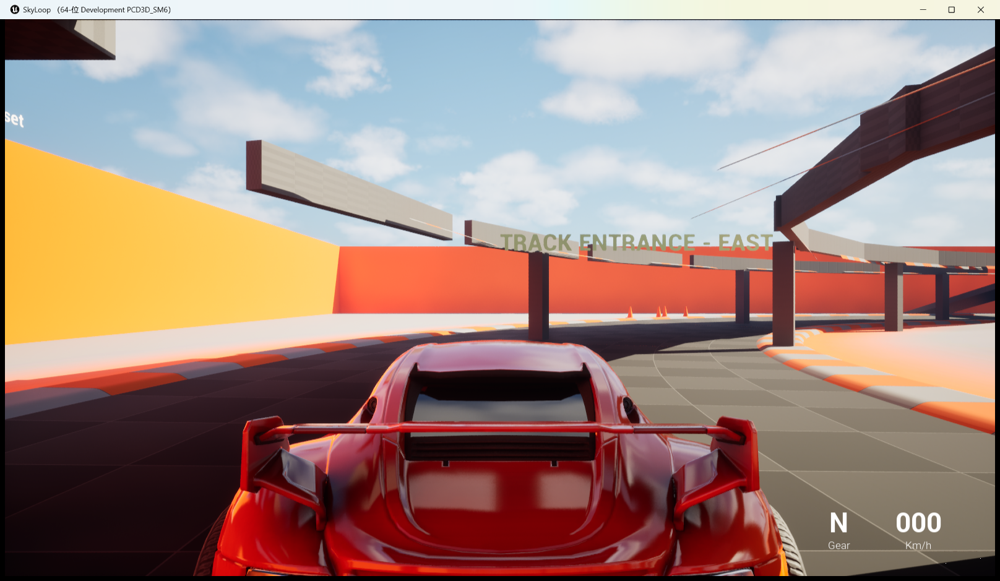

<div align="center">

# 🏁 SkyLoop

**A tiny blueprint-only racing mini-game for Unreal Engine 5.8 —
lap an elevated ring circuit floating above an open valley.**

*No C++ toolchain required. No marketplace assets. Clone, open, press Play.*




</div>

---

## ✨ What's inside

- **An elevated ring circuit** (44 m × 38 m) floating above the valley — 29 modular track tiles,
  guard walls, support pillars, a start/finish gantry and 3 checkpoint gates.
  Every piece is placed by a deterministic editor Python script, so the whole circuit can be
  wiped and rebuilt in about a minute.
- **Recovery ramps on three sides** — fall off the ring, drive to any ramp and climb back up.
- **A lap-timing HUD** drawn in-game (lap number, current time, speed, progress, best & last lap),
  implemented as an editor Python startup script instead of compiled code.
- **Full Chaos vehicle physics** with the sports car from Epic's vehicle template.

## 🚀 Getting started

1. Install [Unreal Engine 5.8](https://www.unrealengine.com/download) through the Epic Games Launcher.
2. Clone this repository and double-click **`SkyLoop.uproject`**.
3. Press **Play**. You spawn on the ground beneath the ring — drive **east**, up the big ramp, and race counter-clockwise.

> 💡 Opening the project the first time may take a minute while shaders compile.

### Controls

| Key | Action |
|---|---|
| `W` / `S` | Throttle / brake–reverse |
| `A` / `D` | Steering |
| `Space` | Handbrake |
| `R` | Reset vehicle |
| `Tab` | Toggle camera |

## 🧰 How it works

This project deliberately avoids compiled C++ so that anyone with the launcher version of UE 5.8 can open it:

| Piece | File | Role |
|---|---|---|
| Track builder | `Tools/build_track.py` | Run headlessly (`-run=pythonscript`), it clears all `SR_*` actors and re-lays the ring, gantry, gates, ramps and signs — terrain-aware and idempotent. |
| Lap-timing HUD | `Content/Python/init_unreal.py` | Auto-executed by the editor at startup (UE's `Content/Python/init_unreal.py` convention). During PIE it tracks the player's ellipse angle each frame, unwraps it into lap progress, and draws the timing board via `Print String`. |
| Everything else | `Content/VehicleTemplate/…` | Epic's Advanced Vehicle template: car blueprints, Chaos wheel setups, input mapping, HUD widget. |

## 🔧 Tune it

The circuit geometry is four numbers at the top of `Tools/build_track.py`:

```python
A, B = 4400.0, 3800.0   # ellipse semi-axes (cm)
CHORD = 900.0           # spacing between track tiles (cm)
TRACK_Z = 350.0         # ring height (cm)
```

Change them, then rebuild:

```bash
UnrealEditor-Cmd.exe <path-to>/SkyLoop.uproject -run=pythonscript ^
  -script="<repo>/Tools/build_track.py" -stdout -unattended -nopause -nosplash -nullrhi
```

## 📁 Project layout

```
SkyLoop/
├── SkyLoop.uproject
├── Config/                  # template settings (maps, game mode, input)
├── Content/
│   ├── VehicleTemplate/     # car blueprints, track tiles, materials, map
│   ├── Vehicles/            # car body/wheel meshes, materials, physics assets
│   ├── Input/Touch/         # thumbstick widget used by the touch UI
│   ├── Python/init_unreal.py  # ★ lap-timing HUD (auto-loaded in the editor)
│   └── __ExternalActors__/  # the placed circuit (World Partition actors)
├── Tools/                   # build/verify/repair scripts for the circuit
└── Screenshots/
```

## 🩺 Troubleshooting

- **"TEXTURE STREAMING POOL OVER BUDGET" flashes while driving.**
  World Partition streams new cells in as you drive and texture demand briefly spikes over the
  streaming pool. It is transient and harmless. If it bothers you, raise the pool on your machine
  via `Config/DefaultScalability.ini` → `[TextureQuality@N]` → `r.Streaming.PoolSize=1500`
  (deliberately *not* baked into the repo — pick a value that fits your GPU).
- **The circuit is gone or partially missing.**
  Re-run `Tools/build_track.py`; it rebuilds every `SR_*` actor from scratch.

## 📜 License & credits

- All code, scripts and configuration: **MIT** — see [LICENSE](LICENSE).
- The vehicle and environment content under `Content/` comes from Epic Games' **Advanced Vehicle
  template** and its template resource packs, subject to the
  [Unreal Engine EULA](https://www.unrealengine.com/eula).

<div align="center">

## 中文说明

**SkyLoop** 是一个纯蓝图 + 引擎 Python 的 UE 5.8 小型赛车游戏：在山谷上空的高架环形赛道上刷圈计时。
克隆仓库 → 用 UE 5.8 打开 `SkyLoop.uproject` → 点 Play → 向东开上大坡道，逆时针开始计时。
出生点在环线正下方的地面，从南/北/东三个坡道都可以上下赛道；屏幕左上角实时显示圈数、圈时、车速与最佳圈速。
赛道由 `Tools/build_track.py` 一键生成，改几个参数即可重建你自己的环形赛道。

</div>
